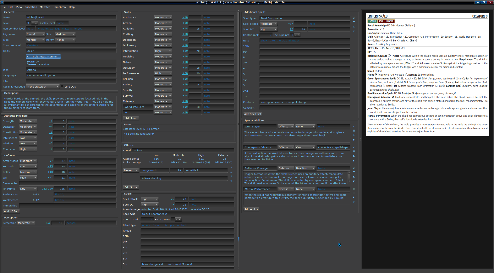
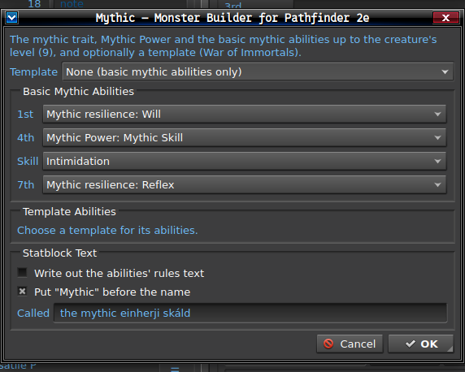
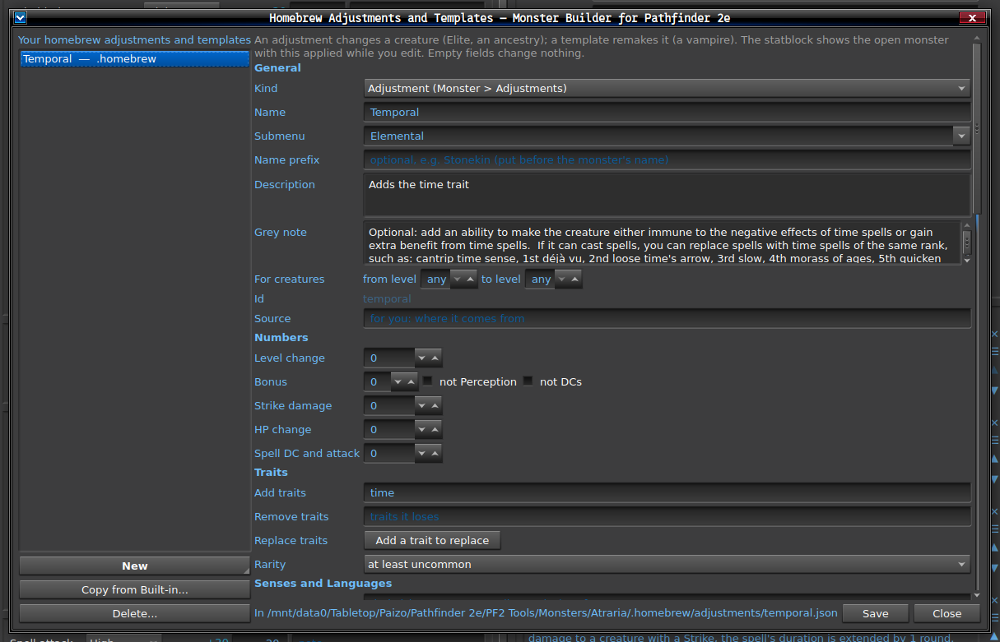

# Monster Builder for Pathfinder 2e

This is a standalone program written in C++ using Qt6 to render custom json files used for the monster.pf2.tools website as images, PDFs, or PF2e Scribe compatible markdown, as well as following the Pathfinder 2e rules and tables for creating monsters.  This was built out of a desire to not rely on a web-based service to produce formatted homebrew monster statblocks for the Pathfinder 2e system.  For my personal use, I like to use a native program wherever possible for my tasks.

## Building and Running

### Dependencies

- Qt 6.4 or newer (Widgets)
- CMake 3.21 or newer
- A compiler with C++20 support
- (optional) fontconfig

On Arch or an Arch-based distro, you can install the dependencies to build this program with

```sh
sudo pacman -S qt6-base cmake fontconfig
```

For other Linux distributions, refer to your distro's package list for these dependencies.  I have only tested this on my EndeavourOS installation.  Theoretically it should compile and run on Windows as well but this is completely untested.

### Building

Simply run `./build.sh` or run

```sh
cmake -B build -DCMAKE_BUILD_TYPE=Release
cmake --build build -j6
```

If you have non-free fonts in your `fonts/` directory (see Fonts below), also add `-DPF2MONSTER_EMBED_ALL_FONTS=ON` so they can be included.

### Running

Simply run `./build/pf2monster`

## Fonts

Fonts are expected to live in a `fonts/` directory next to the executable, in the current directory, or installed system-wide.  Fonts in `fonts/` are built into the executable when you build it.

The expected fonts used are listed in `fonts/README.txt` and any fonts not provided here can be found at the links provided in that README.  If the expected fonts are not installed, the program will use fallback fonts if those are installed.  These fallback fonts can be found in `src/Rendering/Theme.h` and the first one installed is used.

If the Pathfinder-Icons font is not installed, any `:a:`, `:aa:`, `:aaa:`, `:f:`, and `:r:` will render as that text instead of a blank square.  If Pathfinder-Icons is installed, they will be replaced with the proper Pathfinder 2e action icon.

## Features

- Handles entire collections of JSON files to load entire bestiaries.  The list is organized first by subfolders then monsters in the loaded folder.
  - An optional Monster List panel can be opened from View > Monster List to display all loaded JSON files in a tree as a panel on the main UI in the left-most column as opposed to viewing monsters from the Collection menu.
  - Collections, the Find Monster, and Monster List will display up to two sub-folders in a tree, in case sorting by subtype becomes important (e.g. sorting an Elemental into an `Elemental/Fire` directory will show as Elemental > Fire within all three).
- Files are identical to the website's own monster JSON, with custom additions, so they work both ways: anything saved here can be uploaded there.  Import from Website copies the site's JSON into your collection.
- Live preview on a white background, updated as you type.
- Creature levels -1 to 25 are supported, values for level 25 are extrapolated from from the existing tables and cross-referencing against all four of Paizo's official level 25 monsters.
- Road maps: the 13 from GM Core's Building Creatures (brute, soldier, spellcaster, skill paragon, ...) plus 44 class road maps covering all 29 classes released as of October 2026, under Monster > Roadmap.
- Automated application of monster adjustments and templates, under the Monster menu.  Including the Mythic adjustment.
  - Adjustments and templates can be stacked, repeats included, applied in the listed order and reorderable; a warning appears in the General section whenever more than one is applied.
  - Adjustments and templates are non-destructive; the form keeps the base creature as is and all modifications are made in the rendered statblock and are saved out when saving the statblock.
- Some rules are left to the GM and are shown as notes instead of applied.
- References in text such as `[ac]`, `[dex]`, `[dc]`, `[fort]`, and `%` for the creature's name are all replaced in the rendered statblock automatically.
- Renders the statblock in either the Pathfinder 2e theme or the Starfinder 2e theme (difference being mainly the color of the traits boxes).
- Export options: Scribe markdown (to a file, or to the clipboard with Ctrl+Shift+C), PDF (statblock size or an A4 page) and PNG at 300 dpi.
- Add Recall Knowledge DCs and skills automatically to a statblock in one of three possible locations.
- Monsters with separate HP parts, such as hydras, can be created by clicking Add HP Part under the Defense section.  These HP parts are properly rendered in the statblock like Paizo's official hydra statblock.
- Statblock is rendered with all abilities in alphabetical order automatically, no need to manually reorder them.  Exceptions follow Paizo's printed statblocks, such as Mythic Power always appearing first in the offense section and automatic abilities in the Defense section come before reactions.
- Non-combat level can be included for NPC statblocks where the core of the statblock is at one level, but specific skills are set to the recommended values of another level.
- Inclusion of a Homebrew menu to manage homebrew adjustments, templates, roadmaps, domains, and traits.  See Homebrew Management below.

## Screenshots

### Core Interface



### Mythic Template Customization



### Homebrew Management

To make your own adjustments, templates, road maps, domains and traits, see the Homebrew menu.  These options allow you to specify overrides to the rendered statblock, such as replacing traits, adding bespoke abilities for that adjustment or template, adding new strikes, etc.



## AI Disclosure

This project was built using Claude Code.  However, I am a C++ programmer by profession so I am able to read and understand the code that Claude generates.  I aim to extensively test the project using actual monsters I've built on the monster.pf2.tools website.

## License

This project is licensed under GPL version 3, or (at your option) any later version.

The rules content in `resources/` is under the ORC License instead; see LICENSE-ORC and the Legal Notice below.

## Legal Notice

This project is not affiliated with the pf2.tools website.  The original web version is at https://monster.pf2.tools, which this program is modelled on.

This project uses trademarks and/or copyrights owned by Paizo Inc., which are used under Paizo’s Community Use Policy. We are expressly prohibited from charging you to use or access this content. This project is not published, endorsed, or specifically approved by Paizo Inc. For more information about Paizo’s Community Use Policy, please visit paizo.com/communityuse. For more information about Paizo Inc. and Paizo products, please visit paizo.com.

The source code is licensed under GPL-3.0-or-later. The rules content in resources/ (benchmark tables, adjustments, templates, road maps, domains, traits) is Licensed Material under the ORC License; see LICENSE-ORC and the app's credits (Help menu) for the full notice and attribution.

- *Pathfinder GM Core* © 2023 Paizo Inc.: the creature-building benchmark tables, trait abilities and creature road maps ("Building Creatures"), and the DCs by level.
- *Pathfinder Monster Core* © 2024 Paizo Inc.: the Elite and Weak adjustments and the Ghost, Ghoul, Graveknight, Lich, Phantom, Vampire and Werecreature templates.
- *Pathfinder Monster Core 2* © 2025 Paizo Inc.: the Divine Warden, Nosferatu, Nosferatu Thrall and Ravener templates.
- *Pathfinder Player Core* © 2023 Paizo Inc.: domains and domain spells.
- *Pathfinder Lost Omens Divine Mysteries* © 2024 Paizo Inc.: domains and domain spells.
- *Pathfinder Lost Omens Shining Kingdoms* © 2025 Paizo Inc.: the failed prophet template.
- *Pathfinder War of Immortals* © 2024 Paizo Inc.: the mythic rules.
- *Pathfinder Rage of Elements* © 2023 Paizo Inc.: the elemental adjustments (Air, Earth, Fire, Metal, Water, Wood).
- *Pathfinder Howl of the Wild* © 2024 Paizo Inc.: the Amphibious, Frostbound, Sandbound, Miniature, Winged, Twinned and Broodpiercer adjustments.
- *Pathfinder Dark Archive (Remastered)* © 2026 Paizo Inc.: the Experimental, Mutant, Primeval and Rumored Cryptid and Secret Society Member adjustments.
- *Pathfinder NPC Core* © 2025 Paizo Inc.: the Corrupt, Guerrilla, Retired and Union Organizer adjustments and the ancestry adjustments.
- *Pathfinder Adventure Path #207: The Resurrection Flood* © 2024 Paizo Inc.: the floodslain creature template.
- *Pathfinder Lost Omens Cheliax, Infernal Inheritance* © 2026 Paizo Inc.: the shadowbound creature template.
- *Pathfinder Adventure Path #215: To Blot Out the Sun* © 2025 Paizo Inc.: the strigoi template.
